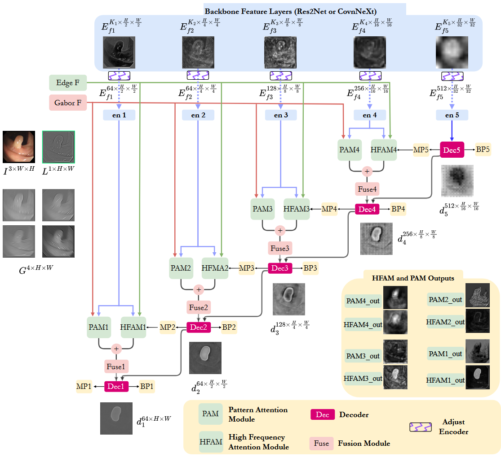
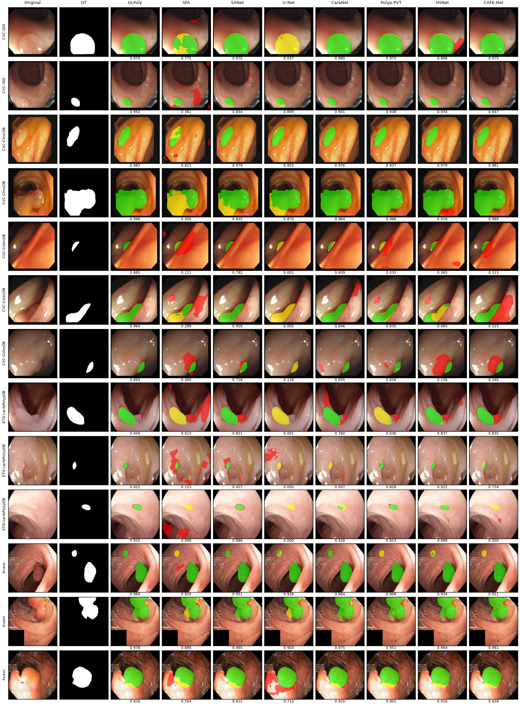
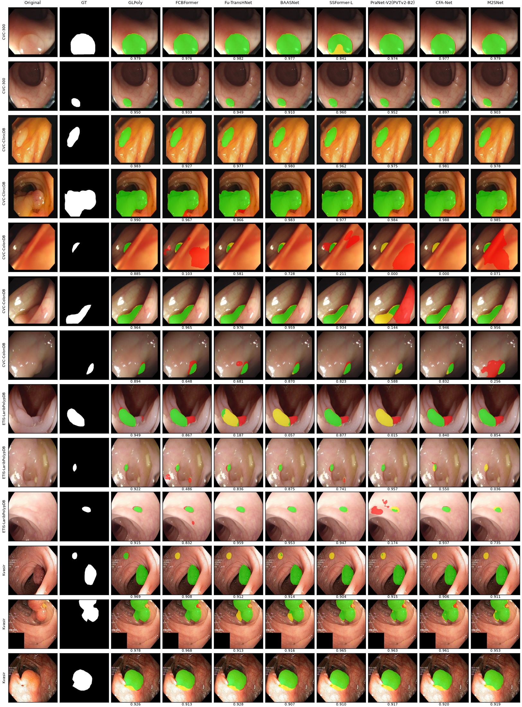
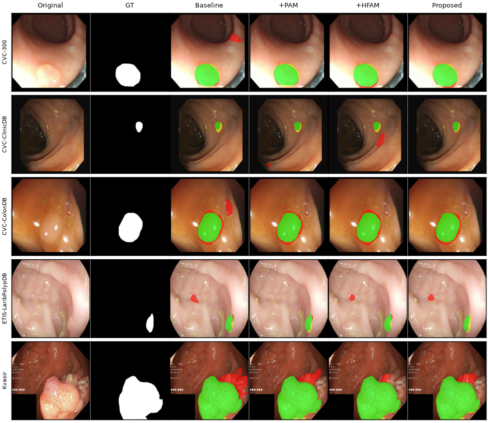

# GLPoly: A High-Frequency Boundary and Texture-Guided Multi-Task Architecture for Colonoscopic Polyp Segmentation

Code, checkpoints, prediction maps and results of GLPoly. The paper is under review; the citation will be added after publication.

<p align="center"></p>

GLPoly uses a ConvNeXt-T encoder and two attention modules fed with fixed image cues: the High-Frequency Attention Module (HFAM) combines a reverse-attention background component, the Laplacian of the previous mask and a Laplacian pyramid edge map; the Pattern Attention Module (PAM) uses Gabor texture features. A coarse-to-fine decoder predicts masks and boundaries with deep supervision.

## Data and protocol

Training and test data follow PraNet: [training set (399.5 MB)](https://drive.google.com/file/d/1YiGHLw4iTvKdvbT6MgwO9zcCv8zJ_Bnb/view), [test set (327.2 MB)](https://drive.google.com/file/d/1Y2z7FD5p5y31vkZwQQomXFRB0HutHyao/view) (links from the [PraNet README](https://github.com/DengPingFan/PraNet)). Put them under `dataset/TrainDataset/` and `dataset/TestDataset/`.

- Split: 1305 training and 145 validation images out of the 1450 training images (Kvasir-SEG 900, CVC-ClinicDB 550); the list is in [`data/split.json`](data/split.json). Test sets: Kvasir 100, ClinicDB 62, ColonDB 380, ETIS 196, CVC-300 60.
- The epoch and the binarization threshold are selected on the validation split. The test sets were not used for epoch, threshold or seed selection. The training recipe (color jitter, CLAHE, backbone learning rate ×0.1) was developed after an error analysis of earlier runs that included test images, so its test scores may be optimistic.
- Metrics: mDice, mIoU, weighted F-measure, S-measure, mean E-measure, MAE, computed by [`glpoly/utils/evaluate.py`](glpoly/utils/evaluate.py) for every method. Unless stated otherwise the PraNet protocol (mean over 256 thresholds) is used.

## Results

### Comparison with published models

mDice on the five test sets. Every row was computed by us with one evaluation code (PraNet protocol: mean over 256 thresholds). The compared methods are published models: their published prediction maps or, for PraNet-V2 and SSFormer-L, maps we generated from the published weights. They were generally trained on all 1450 training images, whereas GLPoly uses 1305 for training and 145 for validation. MEGANet publishes binary maps only, so its scores correspond to a single threshold. Best value per column in bold.

| Method | Kvasir | ClinicDB | ColonDB | ETIS | CVC-300 | Mean |
|---|---:|---:|---:|---:|---:|---:|
| U-Net | 0.818 | 0.823 | 0.504 | 0.398 | 0.710 | 0.651 |
| U-Net++ | 0.821 | 0.794 | 0.481 | 0.401 | 0.707 | 0.641 |
| SFA | 0.723 | 0.701 | 0.456 | 0.298 | 0.468 | 0.529 |
| PraNet | 0.898 | 0.899 | 0.712 | 0.628 | 0.871 | 0.802 |
| ACSNet | 0.898 | 0.882 | 0.716 | 0.578 | 0.863 | 0.787 |
| DCRNet | 0.886 | 0.896 | 0.704 | 0.556 | 0.856 | 0.780 |
| EU-Net | 0.908 | 0.902 | 0.756 | 0.687 | 0.837 | 0.818 |
| HarDNet-MSEG | 0.897 | 0.909 | 0.735 | 0.700 | 0.874 | 0.823 |
| SANet | 0.904 | 0.916 | 0.753 | 0.750 | 0.888 | 0.842 |
| MSNet | 0.906 | 0.918 | 0.752 | 0.723 | 0.866 | 0.833 |
| M2SNet | 0.909 | 0.919 | 0.756 | 0.746 | 0.899 | 0.846 |
| CaraNet | 0.905 | 0.905 | 0.738 | 0.729 | 0.881 | 0.832 |
| CFA-Net | 0.915 | 0.933 | 0.743 | 0.732 | 0.893 | 0.843 |
| PraNet-V2 (Res2Net-50) | 0.907 | 0.923 | 0.679 | 0.640 | 0.898 | 0.809 |
| PraNet-V2 (PVTv2-B2) | 0.915 | 0.931 | 0.767 | 0.764 | 0.899 | 0.855 |
| SSFormer-L | 0.911 | 0.899 | 0.795 | 0.787 | 0.888 | 0.856 |
| MEGANet (ResNet-34) | 0.913 | 0.933 | 0.783 | 0.791 | 0.890 | 0.862 |
| Polyp-PVT | **0.917** | 0.937 | **0.808** | 0.787 | 0.900 | 0.870 |
| **GLPoly (ours)** | 0.916 | **0.941** | 0.783 | **0.814** | **0.908** | **0.872** |

<details><summary>All six metrics per dataset</summary>

**Kvasir**

| Method | mDice | mIoU | F<sub>β</sub><sup>w</sup> | S<sub>α</sub> | mE<sub>φ</sub> | MAE |
|---|---:|---:|---:|---:|---:|---:|
| U-Net | 0.818 | 0.746 | 0.794 | 0.858 | 0.881 | 0.055 |
| U-Net++ | 0.821 | 0.744 | 0.808 | 0.862 | 0.886 | 0.048 |
| SFA | 0.723 | 0.611 | 0.670 | 0.781 | 0.834 | 0.075 |
| PraNet | 0.898 | 0.840 | 0.884 | 0.915 | 0.944 | 0.030 |
| ACSNet | 0.898 | 0.838 | 0.882 | 0.920 | 0.941 | 0.032 |
| DCRNet | 0.886 | 0.825 | 0.868 | 0.911 | 0.933 | 0.035 |
| EU-Net | 0.908 | 0.854 | 0.893 | 0.917 | 0.951 | 0.028 |
| HarDNet-MSEG | 0.897 | 0.839 | 0.885 | 0.912 | 0.942 | 0.028 |
| SANet | 0.904 | 0.847 | 0.892 | 0.915 | 0.949 | 0.028 |
| MSNet | 0.906 | 0.850 | 0.892 | 0.923 | 0.947 | 0.028 |
| M2SNet | 0.909 | 0.853 | 0.901 | 0.923 | 0.950 | 0.025 |
| CaraNet | 0.905 | 0.846 | 0.887 | 0.919 | 0.957 | 0.027 |
| CFA-Net | 0.915 | 0.861 | 0.903 | 0.924 | 0.956 | **0.023** |
| PraNet-V2 (Res2Net-50) | 0.907 | 0.853 | 0.896 | 0.917 | 0.951 | 0.024 |
| PraNet-V2 (PVTv2-B2) | 0.915 | 0.861 | 0.904 | 0.925 | 0.956 | **0.023** |
| SSFormer-L | 0.911 | 0.857 | 0.908 | **0.927** | 0.954 | **0.023** |
| MEGANet (ResNet-34) | 0.913 | 0.862 | 0.904 | 0.916 | 0.954 | 0.026 |
| Polyp-PVT | **0.917** | **0.864** | **0.911** | 0.925 | 0.956 | **0.023** |
| **GLPoly (ours)** | 0.916 | 0.860 | 0.908 | **0.927** | **0.958** | 0.024 |

**ClinicDB**

| Method | mDice | mIoU | F<sub>β</sub><sup>w</sup> | S<sub>α</sub> | mE<sub>φ</sub> | MAE |
|---|---:|---:|---:|---:|---:|---:|
| U-Net | 0.823 | 0.756 | 0.811 | 0.890 | 0.914 | 0.019 |
| U-Net++ | 0.794 | 0.729 | 0.785 | 0.873 | 0.891 | 0.022 |
| SFA | 0.701 | 0.607 | 0.647 | 0.793 | 0.840 | 0.042 |
| PraNet | 0.899 | 0.849 | 0.896 | 0.937 | 0.963 | 0.009 |
| ACSNet | 0.882 | 0.826 | 0.873 | 0.928 | 0.947 | 0.011 |
| DCRNet | 0.896 | 0.844 | 0.890 | 0.934 | 0.964 | 0.010 |
| EU-Net | 0.902 | 0.846 | 0.891 | 0.937 | 0.959 | 0.011 |
| HarDNet-MSEG | 0.909 | 0.864 | 0.907 | 0.939 | 0.961 | 0.007 |
| SANet | 0.916 | 0.859 | 0.909 | 0.940 | 0.972 | 0.012 |
| MSNet | 0.918 | 0.869 | 0.913 | 0.947 | 0.974 | 0.008 |
| M2SNet | 0.919 | 0.870 | 0.917 | 0.946 | 0.974 | 0.009 |
| CaraNet | 0.905 | 0.848 | 0.894 | 0.938 | 0.965 | 0.012 |
| CFA-Net | 0.933 | 0.883 | 0.924 | 0.951 | 0.981 | 0.007 |
| PraNet-V2 (Res2Net-50) | 0.923 | 0.872 | 0.920 | 0.949 | 0.974 | 0.009 |
| PraNet-V2 (PVTv2-B2) | 0.931 | 0.881 | 0.928 | 0.944 | 0.982 | 0.008 |
| SSFormer-L | 0.899 | 0.846 | 0.903 | 0.935 | 0.960 | 0.009 |
| MEGANet (ResNet-34) | 0.933 | 0.888 | 0.931 | 0.950 | 0.980 | 0.008 |
| Polyp-PVT | 0.937 | 0.889 | 0.936 | 0.950 | 0.985 | **0.006** |
| **GLPoly (ours)** | **0.941** | **0.894** | **0.942** | **0.957** | **0.986** | **0.006** |

**ColonDB**

| Method | mDice | mIoU | F<sub>β</sub><sup>w</sup> | S<sub>α</sub> | mE<sub>φ</sub> | MAE |
|---|---:|---:|---:|---:|---:|---:|
| U-Net | 0.504 | 0.436 | 0.490 | 0.710 | 0.691 | 0.059 |
| U-Net++ | 0.481 | 0.408 | 0.467 | 0.693 | 0.680 | 0.061 |
| SFA | 0.456 | 0.337 | 0.366 | 0.628 | 0.661 | 0.094 |
| PraNet | 0.712 | 0.640 | 0.699 | 0.820 | 0.847 | 0.043 |
| ACSNet | 0.716 | 0.649 | 0.697 | 0.830 | 0.839 | 0.039 |
| DCRNet | 0.704 | 0.632 | 0.684 | 0.821 | 0.840 | 0.052 |
| EU-Net | 0.756 | 0.681 | 0.730 | 0.832 | 0.863 | 0.045 |
| HarDNet-MSEG | 0.735 | 0.666 | 0.724 | 0.834 | 0.859 | 0.038 |
| SANet | 0.753 | 0.670 | 0.726 | 0.837 | 0.869 | 0.043 |
| MSNet | 0.752 | 0.671 | 0.736 | 0.838 | 0.872 | 0.041 |
| M2SNet | 0.756 | 0.678 | 0.737 | 0.843 | 0.873 | 0.038 |
| CaraNet | 0.738 | 0.656 | 0.706 | 0.829 | 0.865 | 0.045 |
| CFA-Net | 0.743 | 0.665 | 0.728 | 0.835 | 0.869 | 0.039 |
| PraNet-V2 (Res2Net-50) | 0.679 | 0.611 | 0.668 | 0.801 | 0.815 | 0.049 |
| PraNet-V2 (PVTv2-B2) | 0.767 | 0.687 | 0.752 | 0.845 | 0.885 | 0.036 |
| SSFormer-L | 0.795 | 0.713 | 0.788 | **0.867** | 0.898 | 0.032 |
| MEGANet (ResNet-34) | 0.783 | 0.708 | 0.766 | 0.845 | 0.899 | 0.038 |
| Polyp-PVT | **0.808** | **0.727** | **0.795** | 0.865 | **0.913** | **0.031** |
| **GLPoly (ours)** | 0.783 | 0.713 | 0.773 | 0.861 | 0.897 | 0.033 |

**ETIS**

| Method | mDice | mIoU | F<sub>β</sub><sup>w</sup> | S<sub>α</sub> | mE<sub>φ</sub> | MAE |
|---|---:|---:|---:|---:|---:|---:|
| U-Net | 0.398 | 0.335 | 0.366 | 0.684 | 0.643 | 0.036 |
| U-Net++ | 0.401 | 0.343 | 0.390 | 0.683 | 0.629 | 0.035 |
| SFA | 0.298 | 0.217 | 0.231 | 0.557 | 0.532 | 0.109 |
| PraNet | 0.628 | 0.567 | 0.600 | 0.794 | 0.808 | 0.031 |
| ACSNet | 0.578 | 0.509 | 0.530 | 0.754 | 0.737 | 0.059 |
| DCRNet | 0.556 | 0.496 | 0.506 | 0.736 | 0.742 | 0.096 |
| EU-Net | 0.687 | 0.609 | 0.636 | 0.793 | 0.807 | 0.067 |
| HarDNet-MSEG | 0.700 | 0.630 | 0.671 | 0.828 | 0.855 | 0.015 |
| SANet | 0.750 | 0.654 | 0.685 | 0.849 | 0.881 | 0.015 |
| MSNet | 0.723 | 0.653 | 0.677 | 0.845 | 0.876 | 0.020 |
| M2SNet | 0.746 | 0.669 | 0.712 | 0.853 | 0.880 | 0.017 |
| CaraNet | 0.729 | 0.644 | 0.673 | 0.849 | 0.889 | 0.016 |
| CFA-Net | 0.732 | 0.655 | 0.693 | 0.846 | 0.881 | 0.014 |
| PraNet-V2 (Res2Net-50) | 0.640 | 0.565 | 0.604 | 0.794 | 0.797 | 0.021 |
| PraNet-V2 (PVTv2-B2) | 0.764 | 0.687 | 0.730 | 0.865 | 0.883 | 0.015 |
| SSFormer-L | 0.787 | 0.709 | 0.759 | 0.881 | 0.902 | 0.015 |
| MEGANet (ResNet-34) | 0.791 | 0.711 | 0.753 | 0.866 | **0.915** | 0.015 |
| Polyp-PVT | 0.787 | 0.706 | 0.750 | 0.871 | 0.906 | 0.013 |
| **GLPoly (ours)** | **0.814** | **0.739** | **0.786** | **0.888** | 0.911 | **0.011** |

**CVC-300**

| Method | mDice | mIoU | F<sub>β</sub><sup>w</sup> | S<sub>α</sub> | mE<sub>φ</sub> | MAE |
|---|---:|---:|---:|---:|---:|---:|
| U-Net | 0.710 | 0.627 | 0.684 | 0.843 | 0.847 | 0.022 |
| U-Net++ | 0.707 | 0.624 | 0.687 | 0.839 | 0.834 | 0.018 |
| SFA | 0.468 | 0.330 | 0.341 | 0.640 | 0.644 | 0.065 |
| PraNet | 0.871 | 0.797 | 0.843 | 0.925 | 0.950 | 0.010 |
| ACSNet | 0.863 | 0.787 | 0.825 | 0.923 | 0.939 | 0.013 |
| DCRNet | 0.856 | 0.788 | 0.830 | 0.922 | 0.943 | 0.010 |
| EU-Net | 0.837 | 0.765 | 0.805 | 0.904 | 0.919 | 0.015 |
| HarDNet-MSEG | 0.874 | 0.804 | 0.852 | 0.924 | 0.948 | 0.009 |
| SANet | 0.888 | 0.815 | 0.859 | 0.928 | 0.962 | 0.008 |
| MSNet | 0.866 | 0.799 | 0.848 | 0.926 | 0.945 | 0.010 |
| M2SNet | 0.899 | 0.833 | 0.881 | 0.940 | 0.971 | 0.007 |
| CaraNet | 0.881 | 0.811 | 0.850 | 0.930 | 0.953 | 0.010 |
| CFA-Net | 0.893 | 0.827 | 0.875 | 0.938 | 0.962 | 0.008 |
| PraNet-V2 (Res2Net-50) | 0.898 | 0.827 | 0.878 | 0.937 | 0.975 | 0.006 |
| PraNet-V2 (PVTv2-B2) | 0.899 | 0.831 | 0.885 | 0.940 | 0.970 | 0.007 |
| SSFormer-L | 0.888 | 0.818 | 0.872 | 0.939 | 0.966 | 0.007 |
| MEGANet (ResNet-34) | 0.890 | 0.821 | 0.863 | 0.924 | 0.959 | 0.009 |
| Polyp-PVT | 0.900 | 0.833 | 0.884 | 0.935 | 0.973 | 0.007 |
| **GLPoly (ours)** | **0.908** | **0.845** | **0.892** | **0.943** | **0.976** | **0.005** |

</details>

### Retrained with the same protocol

Each method was retrained once with its official code on our split (1305 training / 145 validation images), with the epoch selected on the validation split, and evaluated with the same code (PraNet protocol). Cells: mDice / mIoU; last column: mean mDice. Deviations from each official recipe are logged in the run's `log.txt` ("TARİF SAPMASI" lines). Best value per column in bold.

| Method | Kvasir | ClinicDB | ColonDB | ETIS | CVC-300 | Mean mDice |
|---|---:|---:|---:|---:|---:|---:|
| HSNet | 0.913 / 0.866 | 0.937 / 0.890 | 0.811 / 0.729 | 0.809 / 0.734 | 0.902 / 0.835 | **0.874** |
| **GLPoly (ours)** | **0.916** / 0.860 | **0.941** / **0.894** | 0.783 / 0.713 | **0.814** / **0.739** | **0.908** / **0.845** | 0.872 |
| Polyp-PVT | 0.914 / 0.862 | 0.931 / 0.884 | **0.815** / **0.733** | 0.801 / 0.721 | 0.894 / 0.827 | 0.871 |
| CAFE-Net | **0.916** / **0.869** | 0.930 / 0.885 | 0.791 / 0.710 | 0.811 / 0.733 | 0.884 / 0.814 | 0.866 |
| FCBFormer | 0.905 / 0.852 | 0.936 / 0.886 | 0.807 / 0.732 | 0.787 / 0.708 | 0.881 / 0.811 | 0.863 |
| SSFormer-L | **0.916** / 0.862 | 0.889 / 0.830 | 0.785 / 0.704 | 0.773 / 0.692 | 0.884 / 0.813 | 0.849 |
| Fu-TransHNet | 0.899 / 0.848 | 0.899 / 0.849 | 0.776 / 0.698 | 0.774 / 0.696 | 0.890 / 0.818 | 0.848 |
| PraNet-V2 (PVTv2-B2) | 0.900 / 0.847 | 0.903 / 0.853 | 0.756 / 0.678 | 0.770 / 0.693 | 0.897 / 0.826 | 0.845 |
| MEGANet (ResNet-34) | 0.898 / 0.843 | 0.929 / 0.877 | 0.763 / 0.685 | 0.738 / 0.663 | 0.858 / 0.778 | 0.837 |
| BAASNet | 0.888 / 0.834 | 0.900 / 0.846 | 0.717 / 0.646 | 0.703 / 0.637 | 0.864 / 0.802 | 0.814 |
| PraNet-V2 (Res2Net-50) | 0.887 / 0.830 | 0.913 / 0.864 | 0.668 / 0.598 | 0.627 / 0.562 | 0.883 / 0.816 | 0.796 |

### Module ablation

mDice (PraNet protocol). Baseline: both modules and their fusion layers removed. Each row is a single run (seed 42).

| Variant | Kvasir | ClinicDB | ColonDB | ETIS | CVC-300 | Mean |
|---|---:|---:|---:|---:|---:|---:|
| Baseline | 0.909 | 0.929 | 0.790 | **0.815** | 0.894 | 0.867 |
| +PAM | 0.915 | 0.934 | **0.802** | 0.804 | 0.878 | 0.867 |
| +HFAM | 0.907 | 0.903 | 0.789 | 0.805 | 0.842 | 0.849 |
| Proposed | **0.916** | **0.941** | 0.783 | 0.814 | **0.908** | **0.872** |

### Component ablation

mDice (PraNet protocol). Each row is a single run with the same training recipe. No boundary loss: the boundary heads are kept but receive no loss. No deep supervision: the mask and boundary losses are applied to the final output only. The full model is seed 42, fixed in advance (it also had the highest validation Dice of the three seeds); each variant was trained once, which favors the full model in this comparison. These are single runs, so the differences are not interpreted as component effects.

| Variant | Kvasir | ClinicDB | ColonDB | ETIS | CVC-300 | Mean |
|---|---:|---:|---:|---:|---:|---:|
| Proposed | 0.916 | **0.941** | 0.783 | **0.814** | **0.908** | **0.872** |
| HFAM without reverse attention | **0.917** | 0.935 | **0.790** | 0.804 | 0.858 | 0.861 |
| HFAM without mask Laplacian | 0.910 | 0.910 | 0.776 | 0.760 | 0.834 | 0.838 |
| HFAM without image edge map | 0.896 | 0.929 | 0.786 | 0.810 | 0.881 | 0.860 |
| Learnable edge filter instead of Laplacian | 0.915 | 0.932 | 0.788 | **0.814** | 0.868 | 0.863 |
| Learnable texture filters instead of Gabor | 0.907 | 0.923 | 0.786 | 0.771 | 0.866 | 0.851 |
| Sobel instead of Laplacian | 0.908 | 0.930 | 0.784 | 0.805 | 0.879 | 0.861 |
| No boundary loss | 0.908 | 0.926 | 0.765 | 0.800 | 0.838 | 0.847 |
| No deep supervision | 0.911 | 0.926 | 0.764 | 0.771 | 0.862 | 0.847 |
| No ECA and spatial attention | 0.908 | 0.926 | 0.777 | 0.790 | 0.872 | 0.855 |

### Evaluation protocols

mDice of GLPoly (seed 42) under three binarization protocols.

| Protocol | Kvasir | ClinicDB | ColonDB | ETIS | CVC-300 | Mean |
|---|---:|---:|---:|---:|---:|---:|
| PraNet protocol (256 thresholds) | 0.916 | 0.941 | 0.783 | 0.814 | 0.908 | 0.872 |
| Validation threshold | 0.922 | 0.946 | 0.788 | 0.818 | 0.911 | 0.877 |
| Fixed threshold 0.5 | 0.921 | 0.947 | 0.787 | 0.819 | 0.913 | 0.877 |

### Visual comparisons

Numbers under the maps: Dice of that image. In the qualitative ablation, green marks true positives, yellow false negatives and red false positives.

<p align="center"></p>

<p align="center"></p>

<p align="center"></p>

## Checkpoints, prediction maps and figures

Everything is in one Google Drive folder: [GLPoly](https://drive.google.com/drive/folders/1o846qyzbIZqx2mBkGqCn9YGzmaz6ioAY). `MANIFEST.json` there lists the size and SHA-256 of every file. Each run folder contains `best.pth` (epoch selected on the validation split), `args.json`, `split.json`, `log.txt`, the results under each protocol, the per-image Dice (`perimage_pranet.csv`), training curves, and two map archives: `maps_pranet.zip` (continuous maps, used for every table) and `maps_binary.zip` (binarized with the validation threshold).

### GLPoly

| Model | Checkpoint | Maps, logs, results | Mean mDice | Used in |
|---|---|---|---:|---|
| GLPoly, seed 42 | [best.pth](https://drive.google.com/file/d/1ym7_tJTFe8WG3GZq8Y9Y0X1KNXla8Dv5/view) (155 MB) | [folder](https://drive.google.com/drive/folders/18ThuCdd35r-aCW5tkdANIAAlk0uOykTE) | 0.872 | all tables |
| GLPoly, seed 1 | [best.pth](https://drive.google.com/file/d/1qf40cLiQpDgUxCj5AXSLOOjM2HpnZr7a/view) (155 MB) | [folder](https://drive.google.com/drive/folders/1yGC3ncgVXIFJfQJQF4l3fYao75XCuvCC) | 0.857 | not in tables |
| GLPoly, seed 2 | [best.pth](https://drive.google.com/file/d/1c_tZzV3MfJORzrJWTsCDfZLQ9ZufZuA0/view) (155 MB) | [folder](https://drive.google.com/drive/folders/1NEJPK4MDV3pUi8Mk9aIOhhQ8VT2qUjNx) | 0.853 | not in tables |

Seed 42 was fixed before training and also has the highest validation Dice of the three seeds; the tables report it. Mean mDice over the three seeds: 0.861 ± 0.010 (sample SD, n=3).

### Ablation runs

| Variant | Checkpoint | Maps, logs, results |
|---|---|---|
| Baseline | [best.pth](https://drive.google.com/file/d/1Q3S9oGp45PynZKbHjIM6u3-TpGafov_t/view) (142 MB) | [folder](https://drive.google.com/drive/folders/1-E-6xJXzPylOAt379WzQVu0gkoj5jsQO) |
| +PAM | [best.pth](https://drive.google.com/file/d/1f9bIJj6b_OITDaLOZtBDDp4vaIukcjKe/view) (145 MB) | [folder](https://drive.google.com/drive/folders/1Fuqh9OGlkrxqPthCg_8J8NfaS_2eHKd9) |
| +HFAM | [best.pth](https://drive.google.com/file/d/16VRDzPodioFklugghnuR12_H4FOyF7-N/view) (151 MB) | [folder](https://drive.google.com/drive/folders/1JUwqhobRVpvbgFilt4ELiszkXG2z0t_b) |
| HFAM without reverse attention | [best.pth](https://drive.google.com/file/d/1K7cubhgTX1kfCGpeUcOYO6hwHDu5-G7G/view) (152 MB) | [folder](https://drive.google.com/drive/folders/1qGLfX8lr2KKm25N-0GD6P6mRfS6Qi_6q) |
| HFAM without mask Laplacian | [best.pth](https://drive.google.com/file/d/1LEU0dpg4is2BlxGNFBzhixydxnekD_BK/view) (152 MB) | [folder](https://drive.google.com/drive/folders/1jBXfUM3ioyCDc_vodAaJgQxvOWg4Ms_5) |
| HFAM without image edge map | [best.pth](https://drive.google.com/file/d/1VCHPq7BOQENbCYAvgcgl_IowvIOF-cI9/view) (152 MB) | [folder](https://drive.google.com/drive/folders/1LrK2NX_yXRv0DGFuj9boFpugMvrBTphr) |
| Learnable edge filter instead of Laplacian | [best.pth](https://drive.google.com/file/d/13VUqkb1KDii8I094hCnQlSxbRPTHJexF/view) (155 MB) | [folder](https://drive.google.com/drive/folders/13vFoPIS5C1BArtL8izFPge4NM6mHOj_8) |
| Learnable texture filters instead of Gabor | [best.pth](https://drive.google.com/file/d/130N9gQxd23J5YJIjOhiMaOqt8zJDDeOV/view) (155 MB) | [folder](https://drive.google.com/drive/folders/1ciQglw1nwKclhdMX4nugyPY_KY1Fr44z) |
| Sobel instead of Laplacian | [best.pth](https://drive.google.com/file/d/1WjfnQX0AD4AAWKuSdeQKQrM0i-waUln9/view) (155 MB) | [folder](https://drive.google.com/drive/folders/1mApKLtJLV3iIsFNX8LlMz_X0rNXQbT59) |
| No boundary loss | [best.pth](https://drive.google.com/file/d/1KEJCUZg-zafAhKy9ofKUBywkZRi5R2FB/view) (155 MB) | [folder](https://drive.google.com/drive/folders/16v3f7phJ3wDMf79KO2dT-Al3vjLlkp1Z) |
| No deep supervision | [best.pth](https://drive.google.com/file/d/1l7s7upHn2Wi8hn1mACypH7Hy0xOFYB56/view) (155 MB) | [folder](https://drive.google.com/drive/folders/1X65t_Np-mAHM-fNOI24vdSpD-sVkrg1e) |
| No ECA and spatial attention | [best.pth](https://drive.google.com/file/d/1QIteCgJot-SzoMId4urbicRfeHS3tCat/view) (155 MB) | [folder](https://drive.google.com/drive/folders/108QlPjuV07JAU5noBgg3pmsi6t7rIB0P) |

### Retrained methods

Checkpoints we trained with each official code under our protocol. Loading them requires the official repository at the listed commit; its license applies to the code.

| Method | Official code (commit) | Code license | Checkpoint | Selected | Maps, log, results |
|---|---|---|---|---|---|
| HarDNet-MSEG | [james128333/HarDNet-MSEG](https://github.com/james128333/HarDNet-MSEG/tree/aac1c4b5d2fdbc80bc8fe21a5377af2d202a0348) @ `aac1c4b` | Apache-2.0 | [checkpoint](https://drive.google.com/file/d/1AJiTZH1N_YLz6wpfL4jlPUcg_eLrGMr7/view) (128 MB) | epoch 31 | [maps, log](https://drive.google.com/drive/folders/1vWp4EzVTji_JpizTtPGzVEMy9wvHhOQp) |
| PraNet-V2 (Res2Net-50) | [ai4colonoscopy/PraNet-V2](https://github.com/ai4colonoscopy/PraNet-V2/tree/ca08522ae77cbda6c5056609e7951b502dbb08f2) @ `ca08522` | MIT | [checkpoint](https://drive.google.com/file/d/1gK_AbaKFGmNk0CVuIoQEA_XstS6jPwIw/view) (125 MB) | epoch 11 | [maps, log](https://drive.google.com/drive/folders/1HYu5Tuqf6Aq5eEvcI0t9N4HbdxgXDYcu) |
| PraNet-V2 (PVTv2-B2) | [ai4colonoscopy/PraNet-V2](https://github.com/ai4colonoscopy/PraNet-V2/tree/ca08522ae77cbda6c5056609e7951b502dbb08f2) @ `ca08522` | MIT | [checkpoint](https://drive.google.com/file/d/1D9htyFPU9EFsQ2svKJyW6baXiypM4dCa/view) (118 MB) | epoch 21 | [maps, log](https://drive.google.com/drive/folders/1dB5UyKZwdGievO6wDeWqgzWpJKcjI9rN) |
| SSFormer-L | [Qiming-Huang/ssformer](https://github.com/Qiming-Huang/ssformer/tree/1351a07dd623c87401aa8d3a316ba03aae5ae123) @ `1351a07` | no license stated | [checkpoint](https://drive.google.com/file/d/1lC62n3tAOyNm-48nCjzbThRn85mp6gZZ/view) (253 MB) | epoch 78 | [maps, log](https://drive.google.com/drive/folders/10PBPxMGDJgvHH81NefA1hFB5cHUvUxeD) |
| MEGANet (ResNet-34) | [UARK-AICV/MEGANet](https://github.com/UARK-AICV/MEGANet/tree/8ae378def060071c3bca5a3f85f22f58dd26559e) @ `8ae378d` | no license stated | [checkpoint](https://drive.google.com/file/d/1D6vjBMk2HBlT7JTdfMJfovOxE93yAqmE/view) (112 MB) | epoch 91 | [maps, log](https://drive.google.com/drive/folders/1ZIWG9XxyKU75RWaMbDvbQZTHSnjsKq2n) |
| Polyp-PVT | [DengPingFan/Polyp-PVT](https://github.com/DengPingFan/Polyp-PVT/tree/cd71fbf9fcd8c32cc0f33699f4e0186073c64dc4) @ `cd71fbf` | research and education only | [checkpoint](https://drive.google.com/file/d/1jqLIFeHxbFjLOF1nHd8sNH5pp9e_9dHr/view) (96 MB) | epoch 97 | [maps, log](https://drive.google.com/drive/folders/1DfMu7jjWCTf0qJXIScxVMPpyC8j1oY9V) |
| HSNet | [baiboat/HSNet](https://github.com/baiboat/HSNet/tree/9d3986a8ada19314bdf6884fed3690ddc0b987ec) @ `9d3986a` | research and education only | [checkpoint](https://drive.google.com/file/d/16hd0wynbGY6AcZ_KelOmTHWK3JC1OxFA/view) (114 MB) | epoch 35 | [maps, log](https://drive.google.com/drive/folders/1i78UAfQlbxWuakRg2cS7rMBTibPWPYb5) |
| CAFE-Net | [shenjoyao/CAFE-Net](https://github.com/shenjoyao/CAFE-Net/tree/5625653ca65797a83eee139a0daa23112273c9e2) @ `5625653` | no license stated | [checkpoint](https://drive.google.com/file/d/1sWnK2Cdd8FRlJywkrDdsJM3wC2Nt-hSp/view) (139 MB) | epoch 148 | [maps, log](https://drive.google.com/drive/folders/10MyH2V80LZthv0V5mybRCeI6tjWegAwm) |
| FCBFormer | [ESandML/FCBFormer](https://github.com/ESandML/FCBFormer/tree/c3531990ddfac6b1ae6153dbfa0ad921ff63dedd) @ `c353199` | Apache-2.0 | [checkpoint](https://drive.google.com/file/d/15Z9UqFQtNkJQGwDoRK3pXilIwLcN0sjE/view) (202 MB) | epoch 68 | [maps, log](https://drive.google.com/drive/folders/1vIKjAq_2VOwyZqu04MMkmZJoL4C-Tfq-) |
| BAASNet | [Khola-naseem/BAASNet](https://github.com/Khola-naseem/BAASNet/tree/3ebd0eb3761f50e32999184e0c7688dd8892fed7) @ `3ebd0eb` | no license stated | [checkpoint](https://drive.google.com/file/d/1fDSUbpaoMp_nxVgyDlw29p1X206dsnKK/view) (369 MB) | epoch 240 | [maps, log](https://drive.google.com/drive/folders/1KAPSGZgPD4Yz5d09MwwTKquRooRLSmKW) |
| Fu-TransHNet | [AGI-FBHC/Fu-TransHNet](https://github.com/AGI-FBHC/Fu-TransHNet/tree/87787076298b557e73f53ff5068cb8f855da3985) @ `8778707` | no license stated | [checkpoint](https://drive.google.com/file/d/155kOOHh5oj23S47TjP6KGuotBlS5iCWJ/view) (270 MB) | epoch 185 | [maps, log](https://drive.google.com/drive/folders/1rqH1hX0w8koh2jPFPMaTBiShG4DLAxzX) |

The retrained HarDNet-MSEG is not in the retraining table; it is the pretraining that Fu-TransHNet requires, trained on the same split.

### Published models: original files and our copies

Original links are taken from the authors' READMEs at the listed commit. A copy is kept in our folder only when the repository license allows redistribution (MIT, Apache-2.0); otherwise only the original link is given. Maps that we generated from official weights are our outputs and are always included. "Archive" rows: the maps come from a comparison package published by another method (PraNet or Polyp-PVT).

| Method | Official code (commit) | Code license | Authors' weights | Authors' maps | Our folder |
|---|---|---|---|---|---|
| U-Net | – | code not inspected | – | [PraNet evaluation package](https://drive.google.com/file/d/1FJxb9DZMzPWFffkbchU0s9Zcf5oe7qcT) (archive) | original only |
| U-Net++ | – | code not inspected | – | [PraNet evaluation package](https://drive.google.com/file/d/1FJxb9DZMzPWFffkbchU0s9Zcf5oe7qcT) (archive) | original only |
| SFA | – | code not inspected | – | [PraNet evaluation package](https://drive.google.com/file/d/1FJxb9DZMzPWFffkbchU0s9Zcf5oe7qcT) (archive) | original only |
| [PraNet](https://arxiv.org/abs/2006.11392) | [DengPingFan/PraNet](https://github.com/DengPingFan/PraNet/tree/95f12bd4e32ec954b5069654abae7de9473fd1f5) @ `95f12bd` | research and education only | [PraNet-19.pth](https://drive.google.com/file/d/1lJv8XVStsp3oNKZHaSr42tawdMOq6FLP) | [PraNet maps](https://drive.google.com/file/d/1CJ6CTUdenumgiKXieuKXFohefRJwyFPY), [PraNet evaluation package](https://drive.google.com/file/d/1FJxb9DZMzPWFffkbchU0s9Zcf5oe7qcT) (archive) | original only |
| ACSNet | – | code not inspected | – | [Polyp-PVT comparison archive](https://drive.google.com/file/d/1xvjRl70pZbOO6wI5p94CSpZK2RAUnUnx) (archive) | original only |
| [DCRNet](https://arxiv.org/abs/2103.06725) | – | code not inspected | – | [Polyp-PVT comparison archive](https://drive.google.com/file/d/1xvjRl70pZbOO6wI5p94CSpZK2RAUnUnx) (archive) | original only |
| [EU-Net](https://arxiv.org/abs/2105.00999) | – | code not inspected | – | [Polyp-PVT comparison archive](https://drive.google.com/file/d/1xvjRl70pZbOO6wI5p94CSpZK2RAUnUnx) (archive) | original only |
| [HarDNet-MSEG](https://arxiv.org/abs/2101.07172) | [james128333/HarDNet-MSEG](https://github.com/james128333/HarDNet-MSEG/tree/aac1c4b5d2fdbc80bc8fe21a5377af2d202a0348) @ `aac1c4b` | Apache-2.0 | [Kvasir-only weights](https://drive.google.com/file/d/1nj-zv64RiWwYjCmWg4NME7HNf_nBncUu) | [Polyp-PVT comparison archive](https://drive.google.com/file/d/1xvjRl70pZbOO6wI5p94CSpZK2RAUnUnx) (archive) | original only |
| [SANet](https://arxiv.org/abs/2108.00882) | [weijun-arc/SANet](https://github.com/weijun-arc/SANet/tree/68da18e4a682cfe8f4e9f679bd52fee07f3f562b) @ `68da18e` | MIT | [weights](https://drive.google.com/file/d/1x6zE73weJ6I_4Vquwe4bt0zf_gahNo0n) | [maps](https://drive.google.com/file/d/1hIJzzKA5aQEyLIRid5PJU9_JZZ4nGkGQ) | [official_maps_copy.zip](https://drive.google.com/file/d/1FvAMjeRneKo-W8V5Vh9lChZhQsSCFk-g/view) (8 MB) |
| [MSNet](https://arxiv.org/abs/2108.05082) | [Xiaoqi-Zhao-DLUT/MSNet-M2SNet](https://github.com/Xiaoqi-Zhao-DLUT/MSNet-M2SNet/tree/0fadc3fe43ceaf4afe6cf154fdb9ab9af375004e) @ `0fadc3f` | no license stated | [weights](https://drive.google.com/file/d/1A3lt0sE4lGxd-UJfpFVWt9k2mRTX1CZN) | [maps](https://drive.google.com/file/d/1G3-lqyz4dfX7h8DVMrCpArGfqLq9Xc0q) | original only |
| [M2SNet](https://arxiv.org/abs/2303.10894) | [Xiaoqi-Zhao-DLUT/MSNet-M2SNet](https://github.com/Xiaoqi-Zhao-DLUT/MSNet-M2SNet/tree/0fadc3fe43ceaf4afe6cf154fdb9ab9af375004e) @ `0fadc3f` | no license stated | [weights](https://drive.google.com/file/d/16_O16md68HDNac2PJLzQKXLMXgAk12je) | [maps](https://drive.google.com/file/d/15OSZ2p3_QLALGdlsHqm9YfZC8dyaEk_2) | original only |
| [CaraNet](https://arxiv.org/abs/2108.07368) | [AngeLouCN/CaraNet](https://github.com/AngeLouCN/CaraNet/tree/052ed72141653b78cda0f66645e471775ae66583) @ `052ed72` | no license stated | – | [maps](https://drive.google.com/file/d/1-tETHh3D_eqs96B1WbpmFAUqBMATwRbE) | original only |
| CFA-Net | [taozh2017/CFANet](https://github.com/taozh2017/CFANet/tree/7b4d91fd77b2d8857036f09172bc319d3dcefd5a) @ `7b4d91f` | research and education only | [CFANet.pth](https://drive.google.com/file/d/1pgvgYebjVVm-QZN-VbGdtYmAyccQmKxZ) | [maps](https://drive.google.com/file/d/1FY2FFDw-VLwmZ-JbJ-h4uAizcpgiY5vg) | original only |
| [PraNet-V2 (Res2Net-50)](https://doi.org/10.26599/CVM.2025.9450510) | [ai4colonoscopy/PraNet-V2](https://github.com/ai4colonoscopy/PraNet-V2/tree/ca08522ae77cbda6c5056609e7951b502dbb08f2) @ `ca08522` | MIT | [RES-V2.pth](https://drive.google.com/file/d/1MFPcbD4Lt3o4d9RAwsT4wfLT32KtLqmF) | – | [maps_from_official_weights.zip](https://drive.google.com/file/d/1OkESOaAvGI-JHehCoM1bH-meZriKClYl/view) (8 MB), [RES-V2.pth](https://drive.google.com/file/d/1Q4JniTmi8AdfwxttYlo9A3W5kibDDHw1/view) (125 MB) |
| [PraNet-V2 (PVTv2-B2)](https://doi.org/10.26599/CVM.2025.9450510) | [ai4colonoscopy/PraNet-V2](https://github.com/ai4colonoscopy/PraNet-V2/tree/ca08522ae77cbda6c5056609e7951b502dbb08f2) @ `ca08522` | MIT | [PVT-V2.pth](https://drive.google.com/file/d/1y5i06UYyESxQfawj9swNhyQcyPX6OD1_) | – | [maps_from_official_weights.zip](https://drive.google.com/file/d/1OTaUNnQEnem0OzVods0y8FGLXY2fL0Gu/view) (4 MB), [PVT-V2.pth](https://drive.google.com/file/d/1jtjJm_AIzZtRXMK-3ioCyk_eyJL7XiSg/view) (118 MB) |
| [SSFormer-L](https://doi.org/10.1007/978-3-031-16437-8_11) | [Qiming-Huang/ssformer](https://github.com/Qiming-Huang/ssformer/tree/1351a07dd623c87401aa8d3a316ba03aae5ae123) @ `1351a07` | no license stated | [ssformer-L](https://drive.google.com/file/d/1CEwUOPm1otoEGfXSvcX-y1x80583-Q9C) | – | [maps_from_official_weights.zip](https://drive.google.com/file/d/1fYdG5EbMM1JJugKPiYQc-QzfKY5j9540/view) (6 MB) |
| [MEGANet (ResNet-34)](https://doi.org/10.1109/WACV57701.2024.00780) | [UARK-AICV/MEGANet](https://github.com/UARK-AICV/MEGANet/tree/8ae378def060071c3bca5a3f85f22f58dd26559e) @ `8ae378d` | no license stated | [MEGANet-ResNet](https://drive.google.com/file/d/1qYL16oPEDvDl0s1lwSwdkMdThZnNBltW) | [maps](https://drive.google.com/file/d/14ZSCxgy-iQXmLb_vE34e-fEHEzhCUZr1) | original only |
| [Polyp-PVT](https://doi.org/10.26599/AIR.2023.9150015) | [DengPingFan/Polyp-PVT](https://github.com/DengPingFan/Polyp-PVT/tree/cd71fbf9fcd8c32cc0f33699f4e0186073c64dc4) @ `cd71fbf` | research and education only | [weights folder](https://drive.google.com/drive/folders/1xC5Opwu5Afz4xiK5O9v4NnQOZY0A9-2j) | [maps](https://drive.google.com/file/d/1L0pFFmd9fbqnJnBwrM9cEV5nlRS32mbQ) | original only |

### Figures

The images of the paper's visual comparisons, at full resolution: [6_figures](https://drive.google.com/drive/folders/1Vb8T1gBtUQlCFnGg3SRzf27h82E0G--q).

## Usage

Python 3.12, PyTorch 2.x with CUDA. The experiments were run on Windows 11 with PyTorch 2.11 (CUDA 12.8) on an RTX 5070 Ti 16 GB.

```bash
pip install torch torchvision --index-url https://download.pytorch.org/whl/cu128
pip install -r requirements.txt
cd glpoly
python check_model.py                       # shape, backward and parameter-group checks

# train GLPoly (the defaults of train.py are not the paper recipe)
python train.py --name glpoly --backbone convnext_tiny --amp --color_aug jitter --clahe_p 0.3 --bb_lr_mult 0.1
# extra seeds keep the same validation split
python train.py --name glpoly_s1 ... --seed 1 --split_seed 42

# test: writes results.md (validation threshold), results_pranet.md, results_th05.md, results_meganet.md and maps
python test.py --name glpoly

# use a released checkpoint: put best.pth under runs/<name>/ and run test.py
# evaluate other methods' maps with the same code
python tools/eval_external.py --methods <name>
```

Runs are written to `runs/<name>/` at the repository root. `--amp` means bf16; fp16 overflowed in the decoder. Ablation flags: `--no_hfam`, `--no_pam`, `--hfam_no_{bg,bdy,edge}`, `--no_attn_refine`, `--edge_op`, `--texture_op`. Code comments and log messages are in Turkish.

`tools/run_retrain.py` retrains a compared method from its official repository on our split; the recipe of every method is in its `RECIPES` dictionary. The repositories are cloned under `downloads/repos/`, except MEGANet and Polyp-PVT, which are expected next to this repository (`../MEGANet`, `../Polyp-PVT`; `pvt_v2_b2.pth` is read from `../Polyp-PVT/pretrained_pth/`). `tools/run_polyppvt.py` retrains Polyp-PVT.

## License

The code in this repository is released under the [MIT License](LICENSE). The compared methods' code, weights and maps keep their own licenses (see the tables above).

